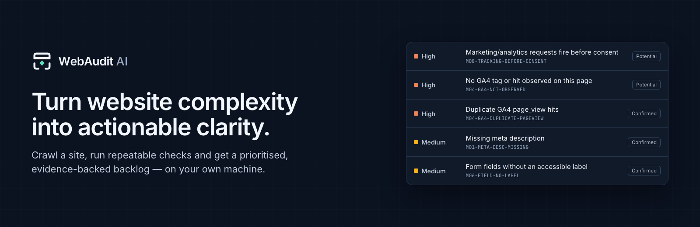
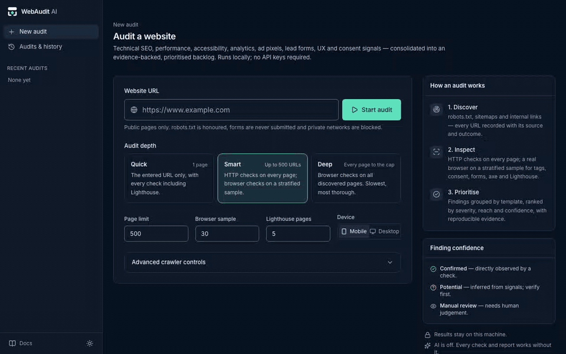
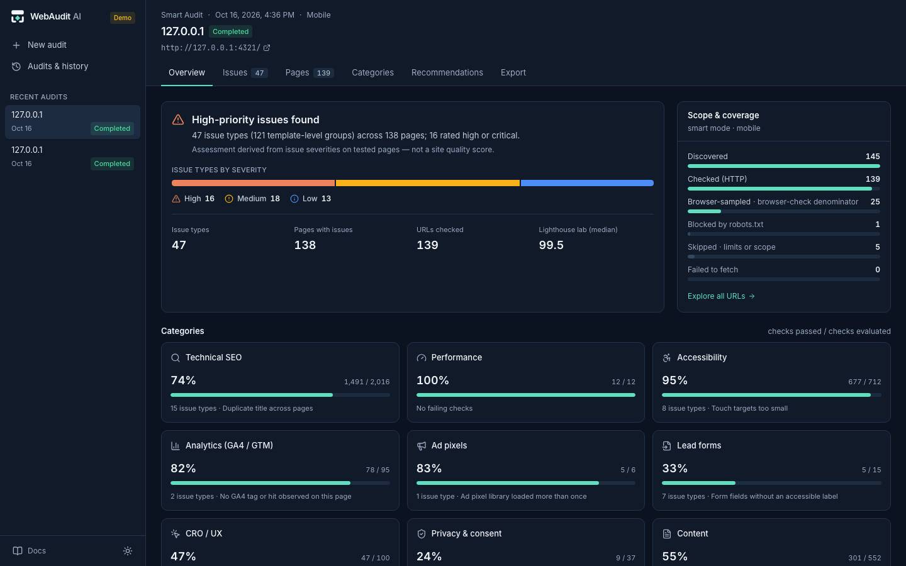
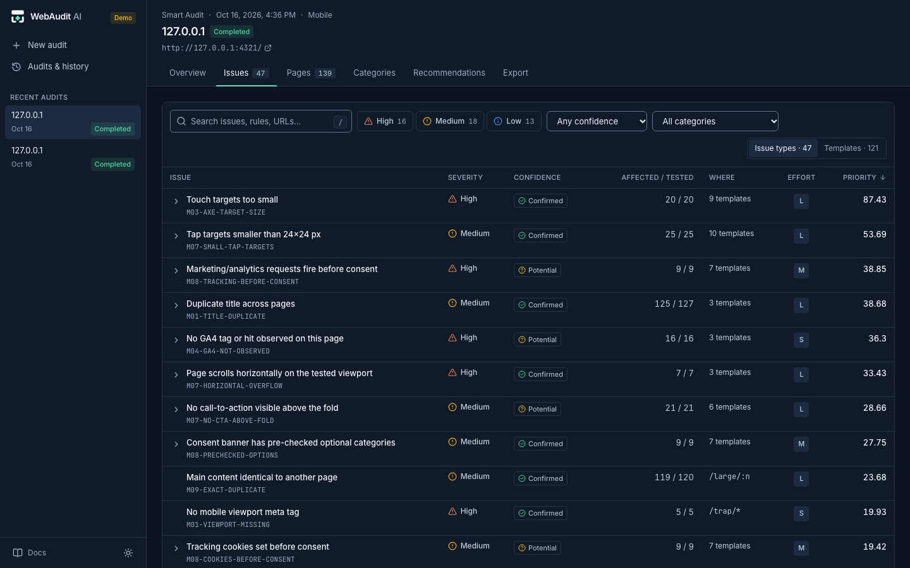
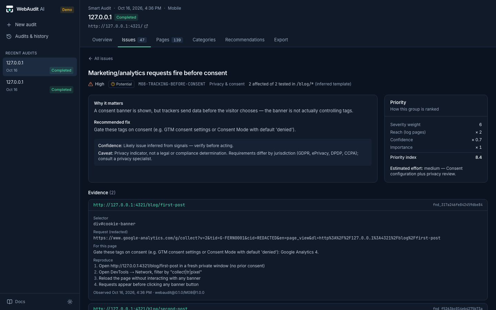
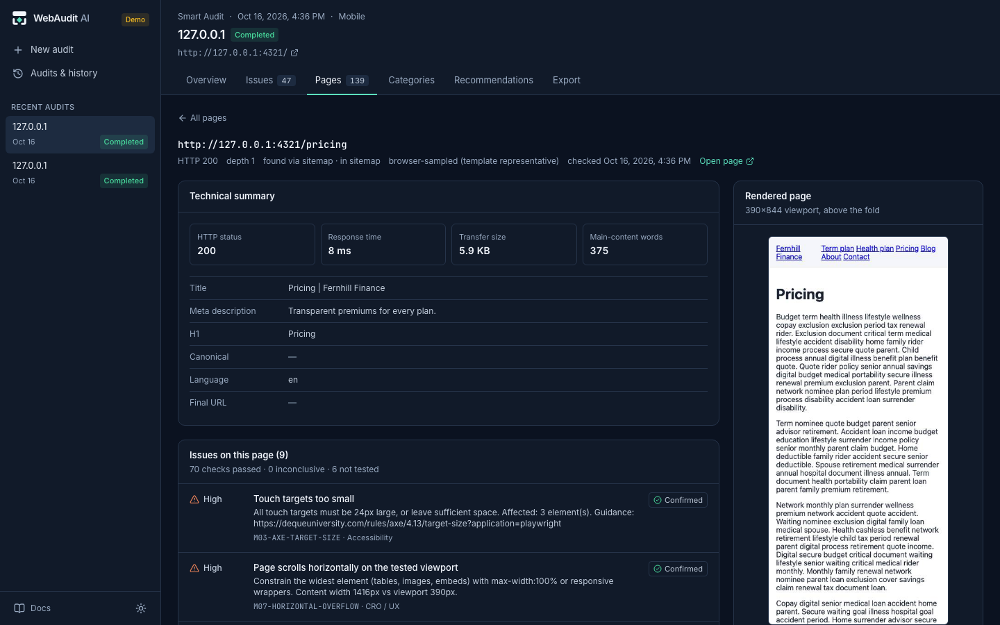
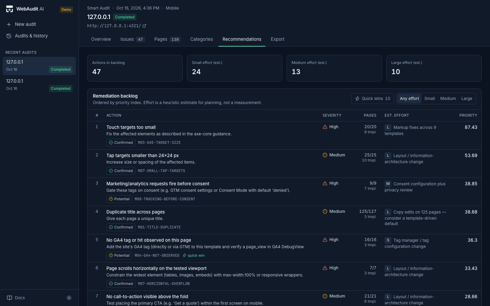
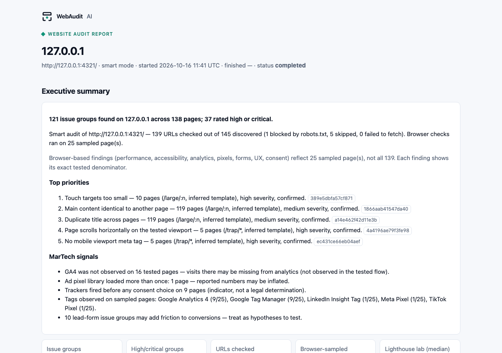
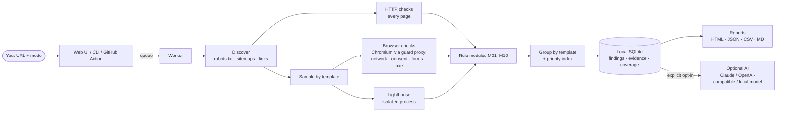

<p align="center"></p>

<h3 align="center">Open-source website intelligence for modern marketers</h3>

<p align="center"><b>Evidence for every fix.</b><br>Audit technical SEO, performance, accessibility, GA4/GTM, ad pixels, lead forms, UX and consent signals on your own machine. Get a prioritised, evidence-backed backlog your marketing and development teams can act on. No account, no SaaS, no API key.</p>

<p align="center">
<a href=".github/workflows/ci.yml"></a>
<a href="LICENSE"></a>


</p>

<p align="center">
<a href="#quick-start">Quick start</a> ·
<a href="#what-webaudit-ai-checks">What it checks</a> ·
<a href="docs/marketing/getting-started.md">Guide for marketers</a> ·
<a href="#how-it-works">How it works</a> ·
<a href="ROADMAP.md">Roadmap</a> ·
<a href="CONTRIBUTING.md">Contribute</a>
</p>



## See it in action

A real recording: submit a URL, watch the live crawl, explore issues and evidence, inspect a page, and export. The audited site is the bundled synthetic test site. [Higher-quality video](docs/images/walkthrough.webm).



|                                                                                    |                                                                                             |
| ---------------------------------------------------------------------------------- | ------------------------------------------------------------------------------------------- |
|                                        |                                                    |
| **Overview**: coverage, top priorities and MarTech signals at a glance             | **Issue explorer**: search, URL-synced filters, confirmed / potential / manual-review tiers |
|                                        |                                                   |
| **Evidence**: selector, redacted request, repro steps, caveats, priority breakdown | **Page inspector**: rendered preview, technical metrics, page-level issues                  |
|                                 |                                              |
| **Recommendations**: prioritised backlog with estimated effort                     | **Report**: a self-contained HTML report to share with stakeholders                         |

Dark ("Midnight Intelligence") and light themes. More: [category report](docs/images/category.png) · [compare audits](docs/images/compare.png) · [light theme](docs/images/dashboard-light.png) · [mobile](docs/images/mobile.png).

## The marketing problem

A website quietly accumulates issues that cost visibility, data quality and trust:

- a release drops the GA4 tag from a template, or fires `page_view` twice
- a cookie banner lets trackers fire before anyone chooses
- a lead form ships with a pre-ticked marketing opt-in
- a canonical points at the staging domain
- product pages lose their meta descriptions

Typical tools report each of these as hundreds of URL-level warnings and a single score. That leaves marketers to work out what matters and developers to work out how to reproduce it.

## What WebAudit AI does

WebAudit AI crawls a site, runs repeatable checks and turns the raw results into **fixable patterns**:

- **Groups findings** by rule and inferred page template, so one template bug reads as one issue.
- **Ranks the backlog** with a transparent priority index. Every factor is shown.
- **Attaches evidence** to every finding: selector, snippet, redacted network request, screenshot, reproduction steps.
- **States its coverage honestly.** Every discovered URL ends in a recorded state (checked, blocked by robots.txt, skipped with a reason, failed). Sampled checks always show their real denominator.
- **Labels confidence**: _Confirmed_ (directly observed), _Potential_ (inferred from signals) or _Manual review_ (needs human judgement).

### Why marketers care

| Question                                          | Where WebAudit AI helps                                                                             |
| ------------------------------------------------- | --------------------------------------------------------------------------------------------------- |
| Is my website technically healthy?                | Category reports show checks passed / evaluated per area, with exact denominators                   |
| What could affect discoverability?                | Technical SEO, content and architecture modules: titles, canonicals, noindex, broken links, orphans |
| Are accessibility problems hurting usability?     | axe-core results with selectors, plus form-label and tap-target checks                              |
| Is analytics implemented as expected?             | GA4 / GTM and ad-pixel observations from a real browser session                                     |
| Are there detectable privacy or consent UX risks? | Trackers and cookies before consent, pre-checked categories, missing reject option                  |
| Which pages have the most important issues?       | Page explorer sorted by failures; template-level grouping                                           |
| What should we fix first?                         | Priority-ranked recommendations with effort estimates and owner hints                               |
| Can I explain this to stakeholders?               | Deterministic executive summary, HTML report, optional AI narrative                                 |

WebAudit AI flags issues and explains why they matter. It does not promise rankings, traffic, conversions or legal compliance. See [Limitations](docs/limitations.md).

## Feature status

| Capability                                                                        | Status                                                                                        |
| --------------------------------------------------------------------------------- | --------------------------------------------------------------------------------------------- |
| 10 audit modules (72 documented rules + dynamic axe rules)                        | ✅ Implemented and tested against a fixture site with planted defects                         |
| Quick, Smart and Deep audit modes                                                 | ✅ Implemented                                                                                |
| Web UI: live crawl, issues, evidence, pages, categories, recommendations, compare | ✅ Implemented                                                                                |
| Exports: HTML, JSON, CSV, Markdown                                                | ✅ Implemented                                                                                |
| CLI with CI budgets (`--budget`, `--fail-on`)                                     | ✅ Implemented                                                                                |
| GitHub Action for marketing QA in CI                                              | ✅ Implemented; self-tested in CI against the fixture site on every change                    |
| Docker image and read-only demo mode                                              | ✅ Published to GHCR (linux/amd64, linux/arm64); smoke-tested in CI; demo mode covered by e2e |
| AI executive summary, 30-day roadmap, Q&A over findings                           | 🤖 Optional, needs your own API key or a local model; adapters are mock-tested                |
| Heuristic and manual-review rules                                                 | 👤 Shown as _Potential_ or _Manual review_; verify before acting                              |
| Postgres database, S3 artifact storage (scale mode)                               | 🗺️ Planned: interfaces exist, implementations do not                                          |
| Authenticated crawling, form submission                                           | ⛔ Out of scope by design                                                                     |

## Quick start

**Requirements:** Node.js ≥ 22.19 and pnpm 9 (`corepack enable` provides it). About 1 GB disk for dependencies and Chromium.

```bash
git clone https://github.com/santoshbpathak/webaudit-ai.git && cd webaudit-ai
pnpm install --frozen-lockfile
pnpm --filter @webaudit/browser exec playwright install chromium   # Linux: add --with-deps
pnpm dev                                                           # UI + worker on http://127.0.0.1:3000
```

**Safe first audit:** the bundled synthetic test site has planted defects.

```bash
pnpm fixture &                                                     # Fernhill Finance on 127.0.0.1:4100
pnpm webaudit --allow-private-host 127.0.0.1 audit http://127.0.0.1:4100/ --mode quick
```

Sample output from that site: [HTML report](examples/fernhill/report.html) · [JSON](examples/fernhill/report.json) · [CSV](examples/fernhill/findings.csv) · [Markdown](examples/fernhill/summary.md).

Audit your own site from the UI, or from the terminal:

```bash
pnpm webaudit audit https://www.example.com --mode smart --out ./report
pnpm webaudit doctor                                               # checks Node, data dir, SQLite, Chromium
```

Detailed setup and troubleshooting: [docs/development/installation.md](docs/development/installation.md).

<details>
<summary><b>Docker</b> (prebuilt image for linux/amd64 and linux/arm64, about 7 GB)</summary>

```bash
export WEBAUDIT_ACCESS_TOKEN=$(openssl rand -hex 24)
docker run --rm -p 127.0.0.1:3000:3000 -e WEBAUDIT_ACCESS_TOKEN \
  -v webaudit-data:/data --shm-size=1g ghcr.io/santoshbpathak/webaudit-ai:0.1.0
open "http://127.0.0.1:3000/?token=$WEBAUDIT_ACCESS_TOKEN"
```

Or build from source with `docker compose -f docker/compose.yaml up --build`.

The container refuses to listen on a network interface without an access token. See [docs/deploy.md](docs/deploy.md) for cloud deployment and the read-only demo.

</details>

## Audit modes

| Mode      | What it does                                                                                                                          | Use it for                     |
| --------- | ------------------------------------------------------------------------------------------------------------------------------------- | ------------------------------ |
| **Quick** | One page, every check including browser checks and Lighthouse                                                                         | A landing page or campaign URL |
| **Smart** | Up to 500 URLs. HTTP checks on every page; browser checks on a stratified sample (one page per inferred template, plus flagged pages) | Routine site audits (default)  |
| **Deep**  | Browser checks on every discovered page up to the cap. Slower                                                                         | Pre-launch or migration QA     |

Page limit, sample size, Lighthouse pages, device, delay and path rules can all be adjusted per audit.

## What WebAudit AI checks

| Module            | Examples                                                                                                                                    | Guide                                                              |
| ----------------- | ------------------------------------------------------------------------------------------------------------------------------------------- | ------------------------------------------------------------------ |
| M01 Technical SEO | status and redirect chains, titles, meta descriptions, canonicals, noindex-in-sitemap, H1s, hreflang, JSON-LD syntax, broken internal links | [SEO guide](docs/marketing/seo-audit-guide.md)                     |
| M02 Performance   | Lighthouse lab score, LCP, CLS, TBT, page weight, render-blocking resources                                                                 | [Understanding scores](docs/marketing/understanding-scores.md)     |
| M03 Accessibility | axe-core rules mapped to severity, with selectors                                                                                           | [Accessibility guide](docs/marketing/accessibility-audit-guide.md) |
| M04 GA4 / GTM     | GA4 not observed, `page_view` missing or duplicated, multiple containers or IDs, empty dataLayer, legacy UA                                 | [Analytics guide](docs/marketing/analytics-audit-guide.md)         |
| M05 Ad pixels     | Meta, Google Ads, LinkedIn, TikTok, X, Microsoft UET, Pinterest, Snap: duplicate or failed loads                                            | [Analytics guide](docs/marketing/analytics-audit-guide.md)         |
| M06 Lead forms    | unlabeled fields, wrong input types, missing autocomplete, pre-ticked opt-ins. Forms are never submitted                                    | [Privacy guide](docs/marketing/privacy-audit-guide.md)             |
| M07 CRO / UX      | CTA above the fold, horizontal overflow, tap targets                                                                                        | [Understanding findings](docs/marketing/understanding-findings.md) |
| M08 Consent       | trackers and cookies before consent, pre-checked categories, no reject option                                                               | [Privacy guide](docs/marketing/privacy-audit-guide.md)             |
| M09 Content       | thin content, missing `lang`, exact and near-duplicates                                                                                     | [SEO guide](docs/marketing/seo-audit-guide.md)                     |
| M10 Architecture  | orphan sitemap pages, click depth, pages missing from the sitemap                                                                           | [SEO guide](docs/marketing/seo-audit-guide.md)                     |

Every rule with its rationale, confidence and caveat: [docs/rules.md](docs/rules.md).

## How it works

<p align="center"></p>



1. **Discover**: robots.txt, sitemaps and links, within scope, with loop and parameter-trap guards.
2. **Inspect**: HTTP checks on every page. A real Chromium session on sampled pages observes network requests, consent behaviour, forms, accessibility and layout. Lighthouse runs in an isolated process.
3. **Prioritise**: findings are grouped by template and ranked:

   ```
   priority = severity weight × min(8, 1 + log2(affected pages)) × confidence × importance
   ```

   This ranks work. It is not a "quality score". See [Scoring](docs/scoring.md).

4. **Report**: a dashboard, exports and an optional AI narrative.

TypeScript monorepo (pnpm + Turborepo, Next.js 16, Playwright, Lighthouse, axe-core, SQLite). Package map: [docs/architecture.md](docs/architecture.md).

## Privacy and local-first

- **Your data stays on your machine.** Audits, evidence and screenshots live in a local SQLite database and folder (`WEBAUDIT_DATA_DIR`). There is no telemetry.
- **Redaction before storage.** Sensitive URL parameters are redacted (tokens, sessions, emails, click IDs). Cookie values are never stored.
- **Safe by design.** Only public pages are audited: private networks, cloud metadata and DNS rebinding are blocked at connect time. Chromium runs behind a guard proxy, with its sandbox on for native installs (in Docker the container is the boundary; see the security model). Forms are never submitted. robots.txt is honoured. A logout/delete/cart denylist always applies.
- **Local instance protection.** The UI binds to `127.0.0.1` and rejects cross-site requests. Network exposure requires an access token.

Details: [Security model](docs/security.md).

## AI: optional and bounded

All findings, scores, groupings and reports are **deterministic** and work with zero API keys. AI is off by default and limited to three tasks:

| Task              | What it does                                    |
| ----------------- | ----------------------------------------------- |
| Executive summary | Plain-language narrative for stakeholders       |
| 30-day roadmap    | Groups the backlog into weekly work with owners |
| Ask the audit     | Q&A over your findings, retrieved locally       |

```bash
WEBAUDIT_AI_PROVIDER=anthropic ANTHROPIC_API_KEY=...                       # Claude
WEBAUDIT_AI_PROVIDER=openai OPENAI_BASE_URL=http://localhost:11434/v1 \
  WEBAUDIT_OPENAI_MODEL=llama3.1                                           # local Ollama, free
```

- You see the exact request and its destination before anything is sent.
- Outputs are labelled "AI suggestion", and must cite finding ids. Invalid citations are flagged.
- AI can never change a finding.
- Calls are capped per audit.

See [docs/ai.md](docs/ai.md).

## Marketing QA in CI

Fail a preview deployment that drops the GA4 tag, ships a pre-ticked opt-in or breaks internal links:

```yaml
- uses: santoshbpathak/webaudit-ai/action@v0.1.0
  with:
    url: https://staging.example.com/
    fail-on: high
    budgets: lh-performance>=80 ga4-missing-pages==0 broken-link-pages==0
```

Budgets fail when the relevant checks did not run, so a missing measurement never passes as success.

## Documentation

| For marketers                                                                                                                                                                                                     | For developers                                                                    |
| ----------------------------------------------------------------------------------------------------------------------------------------------------------------------------------------------------------------- | --------------------------------------------------------------------------------- |
| [Getting started](docs/marketing/getting-started.md)                                                                                                                                                              | [Installation and troubleshooting](docs/development/installation.md)              |
| [Understanding findings](docs/marketing/understanding-findings.md)                                                                                                                                                | [Architecture](docs/architecture.md) · [ADRs](docs/adr)                           |
| [Understanding scores](docs/marketing/understanding-scores.md)                                                                                                                                                    | [Rule reference](docs/rules.md) · [Scoring](docs/scoring.md)                      |
| [SEO](docs/marketing/seo-audit-guide.md) · [Accessibility](docs/marketing/accessibility-audit-guide.md) · [Analytics](docs/marketing/analytics-audit-guide.md) · [Privacy](docs/marketing/privacy-audit-guide.md) | [Security model](docs/security.md) · [Crawling](docs/crawling.md)                 |
| [Reporting to stakeholders](docs/marketing/reporting-guide.md)                                                                                                                                                    | [Deploy](docs/deploy.md) · [Release process](docs/development/release-process.md) |

## Roadmap

Implemented: everything marked ✅ above. Next up: the first public release (`v0.1.0`), community feedback on rule accuracy, then scale mode (Postgres and S3) and rule-documentation links. Full list: [ROADMAP.md](ROADMAP.md).

## Contributing

Developers, SEO specialists, accessibility practitioners and MarTech experts are all welcome:

- **Review the rules.** Is a check accurate? Is the wording fair? Report it with the [audit accuracy template](.github/ISSUE_TEMPLATE/audit_accuracy_issue.yml).
- **Improve the guides.** Plain-language explanations for marketers.
- **Write code.** Rules, fixtures, tests and UI. Start with [`good first issue`](docs/development/good-first-issues.md).

See [CONTRIBUTING.md](CONTRIBUTING.md). Please never share private or client website data in issues.

## Security

Please report vulnerabilities privately, as described in [SECURITY.md](SECURITY.md). Do not open a public issue.

## Licence

[Apache-2.0](LICENSE). Uses Lighthouse (Apache-2.0), axe-core (MPL-2.0, unmodified), Playwright (Apache-2.0), Inter and JetBrains Mono (SIL OFL 1.1) and Lucide icons (ISC). The WebAudit AI name and logo are part of the project's brand; see the [brand guidelines](branding/WEBAUDIT_AI_BRAND_GUIDELINES.md).

## Maintainer

Created and maintained by [@santoshbpathak](https://github.com/santoshbpathak), a digital marketing and MarTech professional, built with AI-assisted development. Contributions and rule reviews from the community are credited in release notes.
